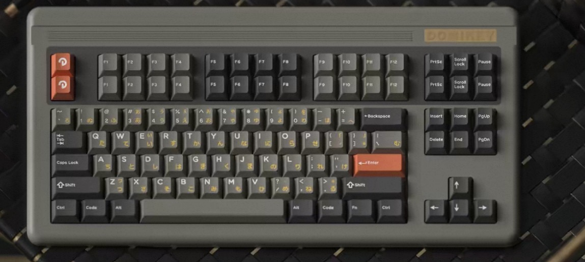
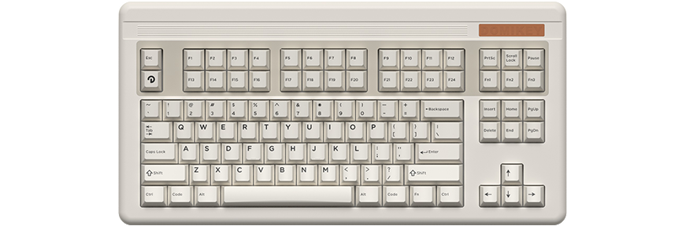
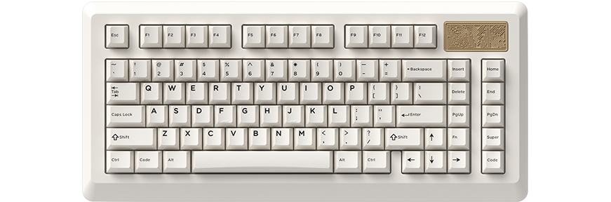
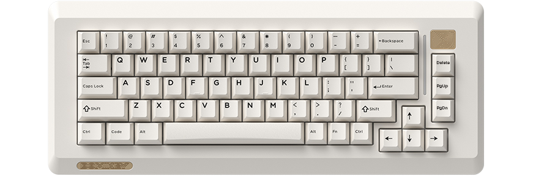
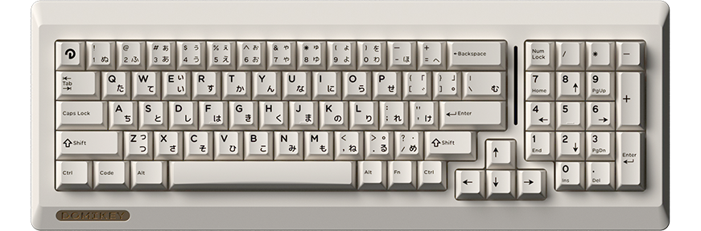

# domikey-babyface-REA

对 Domikey Babyface 键盘官方控制软件（Domikey Driver / Electron + `iot_driver.exe` Rust HID 守护进程）的完整逆向工程，提供**网页端自定义按键管理 Demo（WebHID / Local Node-HID Bridge / Mock 沙盒）**与轻量化 TUI 工具。



## 支持键盘外观预览

| 型号 | 固件代号 | 键数 | 原厂配列渲染图 |
|---|---|---|---|
| **DMK103 (Babyface 103 - 首选)** | `yc3121_afd_fk5255_soc` | 103 键 |  |
| **DMK85** | `yc3121_dmk85_soc` | 85 键 |  |
| **DMK67** | `yc3121_51a5_soc` | 67 键 |  |
| **DMK81** | `yc200_domikey` | 81 键 |  |

## 目录结构

| 路径 | 内容 |
|---|---|
| `domikey-babyface/` | 官方资源压缩包内容（NSIS 安装包 + PDF 说明书） |
| `extracted-app/` | 7z 解包后的完整 Electron 应用（含 `iot_driver.exe`） |
| `recovered-src/` | 从 source map 还原的全部原始 TypeScript 源码 |
| `proto/driver.proto` | 还原的 gRPC 服务定义（渲染层 ↔ `iot_driver.exe`） |
| `docs/REVERSE-ENGINEERING.md` | 深度逆向报告：架构、汇编级 Checksum 算法（`checkSumType 0/1/2`）、4 款型号键位矩阵、HID 命令协议与规划 |
| `tui/` | 网页端自定义按键管理器（`web-server.ts` / `web-app.ts`）+ 协议核心（`hid.ts` / `keyboard.ts` / `keymap-data.ts`）+ TUI（`cli.tsx`） |

## 网页端自定义按键管理 Demo 快速开始

```bash
cd tui
npm install
npm run build

# 运行协议与键位矩阵单元测试（验证 Checksum7/8 与 4 款 Domikey 型号全键位映射）
npm test

# 启动网页端按键管理器（默认监听 http://0.0.0.0:3820）
npm run web
```

打开浏览器访问 `http://127.0.0.1:3820`，支持：
- **4 款 Domikey 键盘型号切换**（默认首选 `DMK103 Babyface 103`）：
  - `DMK103` (`yc3121_afd_fk5255_soc`, PID `0x4011` / `0x4015`, 103 键)
  - `DMK85` (`yc3121_dmk85_soc`, PID `0x4011` / `0x4015`, 85 键)
  - `DMK67` (`yc3121_51a5_soc`, PID `0x4011` / `0x4015`, 67 键)
  - `DMK81` (`yc200_domikey`, PID `0x4011` / `0x4015`, 81 键)
- **多配列层管理**：基础层 `Profile 0 / 1 / 2`（`0x13` 单键下发 / `0x09` 全矩阵分包同步）与 `Fn 层`（`0x15` 单键下发 / `0x10` 全矩阵同步）
- **全类型键值重映射**：108 个标准 HID 键、物理按键实时捕获、组合修饰键（`LCtrl / LShift / LAlt / LGui / RCtrl / RShift / RAlt / RGui`）、多媒体/系统控制、鼠标按键/滚轮、灯效控制、禁用按键
- **3 种通信后端**：
  1. `Mock 沙盒模式`（无需硬件，实时检视 64-byte HID Feature Report 报文与 Checksum 计算结果）
  2. `WebHID 直连`（Chrome / Edge 89+ 直接通过 `navigator.hid` 过滤 `VID 0x3151, UsagePage 0xFFFF` 下发 Feature Report）
  3. `Local Node-HID Bridge`（通过本地 `web-server.js` 的 `/api/hid/write` 接口调用 `node-hid`）
- **配置导入/导出**：支持一键导出/导入 JSON 键位配置文件

## Linux WebHID / hidraw 权限配置

在 Linux 下使用浏览器 WebHID 或非 root 运行 `node-hid` 时，请配置 `udev` 规则以开放 `VID 0x3151` 的 `hidraw` 读写权限：

```bash
sudo tee /etc/udev/rules.d/99-domikey.rules >/dev/null <<'EOF'
SUBSYSTEM=="hidraw", ATTRS{idVendor}=="3151", MODE="0666", TAG+="uaccess"
SUBSYSTEM=="usb", ATTRS{idVendor}=="3151", MODE="0666", TAG+="uaccess"
EOF
sudo udevadm control --reload-rules && sudo udevadm trigger
```

## TUI 命令行模式

```bash
cd tui
npm start
```

## 逆向状态

1. **Electron 渲染层还原**：已从 source map 完整恢复 `recovered-src/` 及 4 款 Domikey 型号矩阵配置。
2. **`iot_driver.exe` 校验和算法攻克**：通过反汇编 `src\dj_hid_device\mod.rs`（VA `0x57465d`–`0x57479c`）完全还原：
   - `checkSumType = 0`（7B 求和取反）：`b[7] = 255 - (sum(b[0..6]) & 0xff)`
   - `checkSumType = 1`（8B 求和取反，用于 `0x07` 灯效等第 8 字节被 RGB 占用的命令）：`b[8] = 255 - (sum(b[0..7]) & 0xff)`
   - `checkSumType = 2`（透传不覆写）
3. **Web 自定义按键管理 Demo**：已完成并通过全量键位协议自检测试。详见 [docs/REVERSE-ENGINEERING.md](docs/REVERSE-ENGINEERING.md)。
