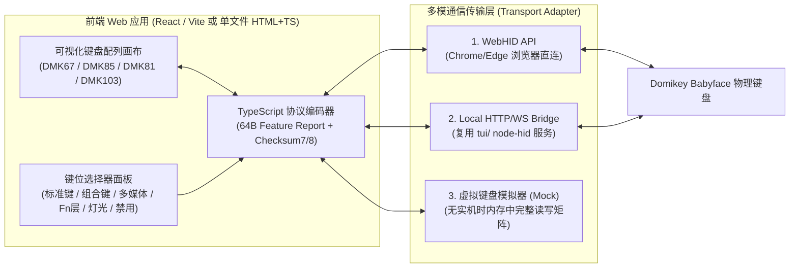

# Domikey Driver 逆向工程深度分析与 Web 自定义按键管理规划

目标:用 REA (<https://github.com/morluto/rea>) 对 Domikey Babyface 键盘控制软件做逆向,
完整还原通信协议、校验和算法与按键矩阵机制,并规划实现一个**可通过网页对键盘自定义按键进行管理的 Demo**。

---

## 1. 样本与本机环境信息

| 项目 | 值 |
|---|---|
| 原始安装包 | `domikey-babyface/Domikey..80.exe` (92 MB, NSIS-3 安装包) |
| 应用 | Electron (32-bit Windows),`Domikey Driver.exe` v1.0.0 |
| 通信驱动 | `extracted-app/app/iot_driver.exe` (5 MB, Rust 编译的 Windows PE32) |
| 构建时间 | 2023-11-17 |
| 源码泄露程度 | **带完整 source map**,已还原全部原始 TypeScript (`recovered-src/`) |
| 本机已安装工具 | `rea` v6.8.0 (`~/.local/bin/rea`)、`opencode` (`~/.opencode/bin/opencode`)、Python 3.12 (`capstone`, `pefile`)、Node.js v22、Rust/Cargo、GNU `objdump`/`gdb` |

---

## 2. 总体架构与逆向过程

1. `7z x Domikey..80.exe` 解出 NSIS 载荷 `$PLUGINSDIR/app-32.7z`,再次解压得到完整 Electron 应用目录 (`extracted-app/`)。
2. `dist/main.js.map` 与 `dist/index.js.map` 含完整 `sourcesContent`,还原出 **2204 个原始 TS/TSX 文件**(主进程 72 + 渲染层 2132),见 `recovered-src/`。
3. 使用 REA (`analyze-javascript-application` / `inspect-pe-imports`) 与 Capstone 反汇编对 `iot_driver.exe` 进行了交叉验证与二进制静态逆向。

```
React 渲染层 (dist/index.js, nodeIntegration=true)
    │  gRPC (明文, 127.0.0.1:3814, proto/driver.proto)
    ▼
iot_driver.exe (Rust: dj_hid_sdk_rs)
    │  USB HID Feature Report (Report ID 0x00 + 64 字节 payload = 65 字节)
    ▼
键盘 / 2.4G 接收器 / 蓝牙 (VID 0x3151 等)
```

---

## 3. Domikey 支持的设备型号与参数表

在 `recovered-src/main/supportYC500Dev.ts` 与 `supportYC200Dev.ts` 中,归属 `company: 'Domikey'` 的键盘型号共 4 款(8 条连接记录,含 2.4G 与有线/蓝牙 SOC):

| 显示型号 | 内部名称 (`name`) | 协议族 | VID : PID | UsagePage : Usage | 层数 (`layer` / `fnLayer`) | 矩阵大小 |
|---|---|---|---|---|---|---|
| **DMK67** (Babyface 65%/68键配列) | `yc3121_51a5_soc` | `YC500Common` | `0x3151 : 0x4011` / `0x4015` | `0xffff : 0x02` | 3 层 / Fn 1 层 | 110 键位槽 (440B) |
| **DMK85** | `yc3121_dmk85_soc` | `YC500Common` | `0x3151 : 0x4011` / `0x4015` | `0xffff : 0x02` | 3 层 / Fn 1 层 | 126 键位槽 (504B) |
| **DMK103** | `yc3121_afd_fk5255_soc` | `YC500Common` | `0x3151 : 0x4011` / `0x4015` | `0xffff : 0x02` | 3 层 / Fn 1 层 | 160 键位槽 (640B) |
| **DMK81** | `yc200_domikey` | `YC200Common` | `0x25a7 : 0x2420` / `0x0461 : 0x4003` | `0x0001 : 0x06` | 4 层 / Fn 1 层 | 126 键位槽 (504B) |

此外通用/引导识别命令 `0x8F` (`FEA_CMD_GET_INFOR`) 返回的报文中,`buf.readInt32LE(1)` (或低 16 位 `buf[2] << 8 | buf[1]`) 即为设备 `id`(例如 DMK67 为 `1336` 或 `-2147484984`)。

---

## 4. `iot_driver.exe` 校验和算法完全还原 (已解决)

通过反汇编 `iot_driver.exe` 的 `src\dj_hid_device\mod.rs` (虚拟地址 `0x57465d`–`0x57479c`、`0x46dd01`–`0x46dddc`、`0x5b30ff`–`0x5b31e4`),完整还原了 `sendMsg` / `sendRawFeature` 的报文封装与 `checkSumType` 计算逻辑:

### 4.1 缓冲区构造 (`0x574660`–`0x5746a4`)
- 驱动首先向发送缓冲区推入 1 字节的 HID Report ID `0x00`,随后追加渲染层传入的 64 字节 `msg`,并用 `0x00` 补齐至 `0x42` (66 字节容量,实际 HID 发送长度为 65 字节:1B Report ID + 64B Feature Report,对应 `featureReportByteLength: 65`)。
- 若为 BLE 蓝牙连接 (`dev_type == 2`),不前置 Report ID `0x00`,直接以 `msg[0]` 作为起始字节。

### 4.2 三种 `checkSumType` 的精确公式 (`0x5746aa`–`0x57479c`)
设 64 字节 Feature Report 载荷为 `b[0..63]` (在 USB/2.4G 模式下位于含 Report ID 缓冲区的 `edx[1..64]`):

1. **`checkSumType = 0` (7字节校验,最常用)**:
   - 汇编逻辑 (`0x574759`–`0x574799`):
     ```asm
     mov ch, byte ptr [esi + 1]
     add ch, byte ptr [esi]
     add ch, byte ptr [esi + 2]
     add ch, byte ptr [esi + 3]
     add ch, byte ptr [esi + 4]
     add ch, byte ptr [esi + 5]
     add ch, byte ptr [esi + 6]
     not ch
     mov byte ptr [edx + 8], ch   ; 即 b[7] = ch
     ```
   - **计算公式**:
     $$b[7] = \sim\left(\sum_{i=0}^{6} b[i]\right) \pmod{256} = 255 - \left(\left(\sum_{i=0}^{6} b[i]\right) \ \& \ 0\text{xFF}\right)$$
   - 这与 TypeScript 源码 `YC200Common.ts:276` 中分片写入时手写的 `b[7] = 255 - (sum & 0xff)` **100% 吻合**!

2. **`checkSumType = 1` (8字节校验,用于 `setLightSetting` / `setSLEDParam` 等携带 RGB 字节 `b[5..7]` 的命令)**:
   - 汇编逻辑 (`0x574712`–`0x57478b`):
     对 `b[0..7]` 共 8 个字节求和后按位取反 (`not ch`),写入 `edx + 9` (即 **`b[8]`**):
   - **计算公式**:
     $$b[8] = 255 - \left(\left(\sum_{i=0}^{7} b[i]\right) \ \& \ 0\text{xFF}\right)$$
   - 原因非常清晰:灯光设置命令中 `b[5]=R, b[6]=G, b[7]=B` 占用了前 8 字节(`b[0..7]`),因此校验和顺延存放在第 9 字节 `b[8]`!

3. **`checkSumType = 2` (免驱动重算 / 原样直发)**:
   - 汇编逻辑 (`0x5746fb`): 当 `checkSumType` 不为 0 或 1 时,直接跳过求和(`jmp 0x57479c`),原样发送缓冲区(用于调用方已在 JS 层算好 `b[7]` 校验和的分片包,或 OTA/初始化包)。

---

## 5. 自定义按键管理协议深度解析 (` YC500Common` / `YC200Common`)

要实现网页端对键盘自定义按键的管理,核心涉及以下 HID 命令与数据结构:

### 5.1 键位矩阵数据结构 (`defaultMatrix` 与 4 字节键位项)
- 每个物理按键在矩阵中占 **4 字节** (`[type_or_flag, mod_or_p1, key_or_p2, key2_or_p3]`)。
- 以 `yc3121_51a5_soc` (DMK67) 为例:
  - `recovered-src/index/res/layout/yc500/yc3121_51a5_soc.ts` 定义了 67 个可视按键的 UI 坐标 `(x, y, w, h)`、显示名称 `keyName` 与默认 HID 键值 `value`。
  - `recovered-src/index/sdk/DriverIO/DeviceAPI/yc500/yc3121_51a5_socMatrix.ts` 定义了长度为 440 字节(110 个槽位 × 4 字节)的硬件扫描矩阵映射表 `defaultMatrix`。
  - 给定某个按键的默认 `hid` 码(如 `Esc` = 41, `A` = 4),通过在 `defaultMatrix` 中按 4 字节步进查找 `[0, 0, hid, 0]` (或特殊键 4 字节序列),即可得到该按键在硬件矩阵中的**槽位索引 `keyIndex` (`0` ~ `109`)**。

### 5.2 4 字节按键配置编码格式 (`changeArr[0..3]`)
在 `dk2017.ts` / `yc500Common.ts` 与 `res/映射.ts` 中,任意自定义按键配置最终被编码为 4 字节数组 `changeArr`:

| 功能类型 | 4 字节编码 `[B0, B1, B2, B3]` | 说明与示例 |
|---|---|---|
| **默认单键 / 改键** | `[0x00, 0x00, hidCode, 0x00]` | 标准 USB HID Usage ID,如 `A`=4, `Enter`=40, `Space`=44, `F1`=58 |
| **组合键 (`combo`)** | `[0x00, modMask, key1, key2]` | `modMask`: Ctrl=`1`, Shift=`2`, Alt=`4`, Win=`8` (`skeyToHidTable`);可带单键或双修饰键 |
| **禁用按键 (`forbidden`)** | `[0x00, 0x00, 0x00, 0x00]` | 4 字节全 0 表示禁用该键 |
| **多媒体与系统功能** | `[0x03, 0x00, usageLo, usageHi]` | 音量加 `[3, 0, 0xe9, 0]`、音量减 `[3, 0, 0xea, 0]`、静音 `[3, 0, 0xe2, 0]`、播放/暂停 `[3, 0, 0xcd, 0]`、计算器 `[3, 0, 0x92, 1]` |
| **层切换与特殊硬件功能** | `[0x0a, subCmd, p1, 0x00]` | `Fn` 键 `[0x0a, 0x01, 0, 0]`、`r_FN` `[0x0a, 0x01, 1, 0]`、音量/亮度旋钮切换 `[0x0a, 0x0e, 0, 0]` |
| **灯光控制热键** | `[0x0d, subCmd, p1, p2]` | 灯效切换 `[0x0d, 1, 0, 0]`、亮度加 `[0x0d, 2, 1, 0]`、亮度减 `[0x0d, 2, 2, 0]` |
| **无线/设备切换热键** | `[0x0e, subCmd, chan, 0x00]` | 2.4G `[0x0e, 0, 0, 0]`、蓝牙1~3 `[0x0e, 0, 1..3, 0]`、有线 `[0x0e, 0, 4, 0]` |
| **鼠标按键映射** | `[0x01, 0x00, btnMask, 0x00]` 等 | 左键、右键、中键、滚轮上下 (`mouseKeyTable`) |
| **宏绑定 (`ConfigMacro`)** | `[0x09, macroType, macroIndex, 0x00]` | `macroType`: 0=按次重复, 1=开关触发, 2=按住循环;`macroIndex`: 0~49 |

### 5.3 读取与写入按键配置的 HID 命令

#### (1) 读取全键矩阵 (`_getKeyMatrix` / `_getFnKeyMatrix`)
- **读取普通层 (`0x89`)**:
  循环 `page = 0..7` (DMK103 为 `0..9`),每次发送 `b[0] = 0x89, b[1] = profile (0..2), b[2] = page`,计算 `checkSumType = 0` (`b[7]`),每次 `readFeature` 读取 64 字节,拼接得到完整的 512 字节(或 640 字节)矩阵数据,截取前 `defaultMatrix.length` 字节即可解析出当前所有按键的映射状态。
- **读取 Fn 层 (`0x90`)**:
  循环 `page = 0..7`,发送 `b[0] = 0x90, b[1] = fnIndex, b[2] = page`,读取拼接。

#### (2) 单键快速改键 (`YC500Common` 专有命令 `0x13` / `0x15`)
DMK67 / DMK85 / DMK103 均属于 `YC500Common`,支持**单键即时改键命令**,无需每次重刷整个矩阵:
- **普通层单键修改 (`0x13` `FEA_CMD_SET_KEYMATRIX_SIMPLE`)**:
  ```
  b[0] = 0x13
  b[1] = profile (0 ~ 2)
  b[2] = keyIndex (在 defaultMatrix 中的槽位序号)
  b[3..6] = 0
  b[7] = 255 - ((b[0]+b[1]+b[2]) & 0xff)   // checkSumType = 0
  b[8..11] = changeArr[0..3]               // 4字节新键位配置
  ```
- **Fn 层单键修改 (`0x15` `FEA_CMD_SET_FN_SIMPLE`)**:
  同上,仅 `b[0] = 0x15, b[1] = fnIndex`。

#### (3) 全矩阵批量覆写 (`0x09` / `0x10`,兼容 `YC200Common` DMK81 及全量恢复)
- 分 9 页(每页携带 56 字节矩阵数据 + 8 字节包头 = 64 字节):
  - 包头 `b[0] = 0x09` (Fn 层为 `0x10`), `b[1] = profile`, `b[2] = 0xf8`, `b[3] = 0x01`, `b[4] = page (0..8)`, `b[5..6] = 0`, `b[7] = 255 - (sum(b[0..6]) & 0xff)`。
  - 载荷 `b[8..63]` = `matrix.slice(page * 56, (page + 1) * 56)`。

#### (4) 配置档切换与恢复出厂
- **读取/设置当前层 (`Profile`)**: `0x85` / `0x05` (`b[1] = profile 0..3`)。
- **恢复出厂默认设置 (`Reset`)**: `0x02` (`FEA_CMD_SET_RESERT`,发送 `[0x02, 0, ..., 0, 0xfd]`)。

---

## 6. 网页端自定义按键管理 Demo 总体规划 (Roadmap)

为了实现“**通过网页对键盘自定义按键进行管理**”的最终目标,我们设计一套**双模架构(WebHID 浏览器直连 + 本地 Node.js Bridge 代理 + 硬件模拟器 Mock 模式)**,既能像 VIA / Vial 一样在 Chrome/Edge 中零安装直连键盘,又能通过本地后端兼容权限受限环境或在无实机连接时完整演示所有交互。



### 阶段一:核心协议库与校验和补全 (`tui/src/` & 共享协议层)
1. **补全 `tui/src/hid.ts` 中的校验和函数**:
   - 实现已逆向验证的 `checksum7(buf)` (`b[7] = 255 - (sum(b[0..6]) & 0xff)`) 与 `checksum8(buf)` (`b[8] = 255 - (sum(b[0..7]) & 0xff)`),注意 HID `sendFeatureReport` 首字节需前置 Report ID `0x00` (共 65 字节)。
2. **提取 Domikey 4 款型号的完整レイアウト与矩阵字典**:
   - 将 `recovered-src` 中的 `yc3121_51a5_soc` (DMK67)、`yc3121_dmk85_soc` (DMK85)、`yc3121_afd_fk5255_soc` (DMK103)、`yc200_domikey` (DMK81) 的视觉坐标 (`layout`)、硬件矩阵 (`defaultMatrix`) 及 HID 键名映射表 (`映射.ts`) 提取为独立、零外部依赖的协议模块 `keymap-data.ts`。
3. **封装按键读写 API**:
   - 实现 `getKeyMatrix(profile)`、`getFnKeyMatrix(fnLayer)`、`setKeySingle(profile, keyIndex, changeArr)` (`0x13`/`0x15`)、`setKeyMatrixFull(profile, matrix)` (`0x09`/`0x10`) 以及 `resetKeyboard()` (`0x02`)。

### 阶段二:多模传输层设计 (WebHID + Node-HID 本地服务 + 离线模拟器)
1. **WebHID 直连驱动 (`WebHidTransport`)**:
   - 利用浏览器原生 `navigator.hid.requestDevice({ filters: [{ vendorId: 0x3151 }, ...] })`,直接通过 `device.sendFeatureReport(0, data)` 与 `device.receiveFeatureReport(0)` 收发 64 字节 Feature Report,无需安装任何后台程序。
2. **Node.js 本地桥接服务 (`NodeHidBridge`)**:
   - 扩展现有仓库的 Node.js 代码,提供一个轻量级 HTTP/WebSocket 接口 (`/api/devices`, `/api/keymap`, `/api/key`, `/api/light`),底层调用 `node-hid`,方便在不支持 WebHID 的浏览器或需要免授权弹窗时使用。
3. **虚拟键盘沙盒 (`MockDeviceTransport`)**:
   - 内置完整的键盘固件状态机模拟(维护各层 `matrix` Buffer、当前 `profile`、灯效参数与电量),即使不插物理键盘也能在网页上体验完整的“读取键位 → 点击按键 → 修改映射/组合键 → 写入报文 → 实时抓包日志预览 → 导出/导入 JSON 配置”全流程。

### 阶段三:网页端自定义按键管理 Demo (`web/` 目录)
1. **交互式键盘可视化画布**:
   - 基于从 `recovered-src/index/res/layout/` 还原的精确键位坐标与宽高 `(x, y, w, h)`,1:1 渲染 DMK67 (Babyface) 等型号的拟物/扁平化键盘布局。
   - 每个按键实时显示:**默认键名** + **当前自定义映射角标**(若已改键则高亮显示,禁用则标红)。
2. **多维度按键自定义面板**:
   - **层切换栏**:支持切换 `Profile 0 / 1 / 2` 与 `Fn 层`、切换键盘型号预览。
   - **映射分类标签页**:
     - **基础键位**:全配列字母、数字、符号、F1~F12、编辑键、小键盘键点选或直接按物理键盘捕获(`Key Capture`)。
     - **组合键构建器 (`Combo`)**:一键勾选 `Ctrl` / `Shift` / `Alt` / `Win` + 目标键,生成 `[0x00, modMask, key, 0x00]`。
     - **多媒体与系统控制**:音量加减、静音、播放控制、计算器、锁屏、切换层 (`Fn`)、灯光控制键、无线通道切换键。
     - **禁用按键 / 恢复单键默认 / 整层重置**。
3. **实时 HID 报文监控台 (Protocol Inspector)**:
   - 在网页底部或侧栏实时展示每一次点击“应用改键”或“读取配置”时生成的 **64 字节 Feature Report 十六进制报文**(高亮标注命令码 `b[0]`、键位槽索引 `b[2]`、校验和 `b[7]`/`b[8]` 及 4 字节键位值 `b[8..11]`),直观验证逆向成果。
4. **配置导入/导出**:
   - 支持将自定义键位方案导出为 JSON 文件或从本地加载并一键刷入键盘。

### 阶段四:联调、测试与文档交付
1. 编写单元测试验证 `checksum7` / `checksum8`、键位矩阵索引查找 (`findIndexInDefaultMatrix`)、4 字节编码/解码 (`matrixToConfigValues` ↔ `configToChangeArr`) 与原厂源码行为 100% 一致。
2. 提供 Linux `udev` 规则配置说明 (`/etc/udev/rules.d/99-domikey.rules`,允许非 root 用户与 Chrome WebHID 直接访问 `VID 0x3151` 的 `/dev/hidraw*`)。
3. 启动并验证 Web Demo 服务,确保可视化改键、层切换、灯光调节与报文监控均可流畅运行。
